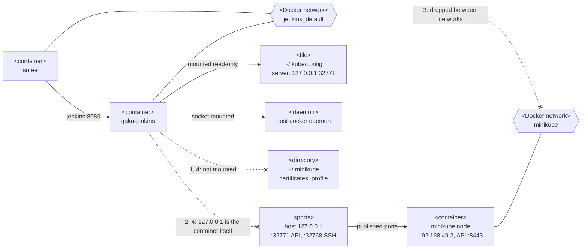
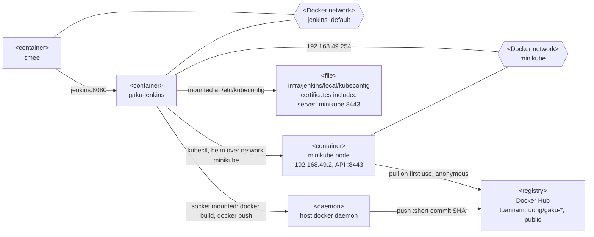

# Local Jenkins deploy plan, v4: images through Docker Hub

The local Jenkins pipeline should deploy every push to `master` into minikube, but its Load and Deploy stages fail on
every build: the `gaku-jenkins` container (local Jenkins server `infra/jenkins/local/docker-compose.yml`) can't reach minikube.

## 1. Why the container cannot reach minikube

Inside `gaku-jenkins` container:

1. **Certificate files are missing.** The `minikube` entry in `~/.kube/config` names three files under `~/.minikube/`
   instead of including them. 
   - kubectl uses `ca.crt` to check the API server's certificate
   - `client.crt` with `client.key` to log in as `minikube-user` in the group `system:masters`. 
   Only `~/.kube` is mounted, so `kubectl` stops with `unable to read client-cert`.
2. **The server address is the host's loopback.** The entry points at `https://127.0.0.1:32771`, a port docker
   publishes only on the host's `127.0.0.1`. Inside the container, `127.0.0.1` is the container itself, and nothing
   answers.
3. **The node's own address is blocked.** The node listens on `192.168.49.2:8443`, its address on the docker network
   `minikube`. Jenkins sits only on `jenkins_default`, and docker drops traffic between two different networks on one
   host, so that address gets no answer from Jenkins either.
4. **`minikube image load` runs into items 1 and 2 again.** Three problems:
   - It reads the minikube profile from `~/.minikube`, which is not mounted, so the container reports
     `Profile "minikube" not found`.
   - It copies the image to the node over SSH at `127.0.0.1:32768`, a port open only on the host's loopback, as in
     item 2.
   - It needs write access to `~/.minikube/cache`, where it saves the image before copying it to the node, so a mount
     that supplies the profile would also have to be writable.

## 2. Fix

### 2.1 Minikube access

Fixes items 1 to 3 in [§1 Why the container cannot reach minikube](#1-why-the-container-cannot-reach-minikube):
[§2.1.1 Network](#211-network) item 3, [§2.1.2 Kubeconfig](#212-kubeconfig) items 1 and 2.

#### 2.1.1 Network

In `infra/jenkins/local/docker-compose.yml`, connect Jenkins to the minikube network in addition to its own:

```yaml
services:
  jenkins:
    networks:
      default:
      minikube:
        ipv4_address: 192.168.49.254

networks:
  minikube:
    external: true
```

`default` keeps the `smee` container's route to `http://jenkins:8080`. 

The fixed address keeps Jenkins off `192.168.49.2`. The node container holds that address as a static IP, but docker
hands it to the next container that joins while the node is stopped, and `minikube start` then fails with
`failed to set up container networking: Address already in use`. 

#### 2.1.2 Kubeconfig

Give Jenkins its own kubeconfig with the certificates included in the file and the server reached by the container 
name `minikube`. The API server's certificate lists `minikube` as a valid name, so no IP is
written into the file.

`infra/jenkins/jenkins.mk`:

```make
jenkins_kubeconfig:
	@CFG=$$(kubectl config view --minify --flatten --context minikube) || exit 1; \
	echo "$$CFG" | sed -E 's#server: https://127.0.0.1:[0-9]+#server: https://minikube:8443#' \
	  > $(JENKINS_FOLDER)/kubeconfig; \
	chmod 600 $(JENKINS_FOLDER)/kubeconfig

jenkins_up: jenkins_kubeconfig
jenkins_rebuild: jenkins_kubeconfig
```

`infra/jenkins/local/docker-compose.yml`: drop the `~/.kube` mount, and point `KUBECONFIG` at the new file:

```yaml
    environment:
      KUBECONFIG: /etc/kubeconfig
    volumes:
      - ./kubeconfig:/etc/kubeconfig:ro
```

- **No restart needed after regenerating.** `>` writes into the existing file instead of replacing it, so a running
  container sees the new content after `make jenkins_kubeconfig`.
- **Missing file.** If the file does not exist when compose starts, docker creates a directory in its place. The make
  prerequisite prevents that.
- **Permissions.** The `jenkins` user is uid 1000, the file's owner, so mode 600 still lets it read the file.

### 2.2 Images through Docker Hub

Fixes item 4 in [§1 Why the container cannot reach minikube](#1-why-the-container-cannot-reach-minikube).

The host's docker daemon pushes the images to Docker Hub and the node pulls them from there, so the pipeline no
longer runs `minikube image load`.

#### 2.2.1 Docker Hub credential

1. hub.docker.com → Account settings → Personal access tokens → Generate, with access **Read & Write**. The token in
   the root `.env` has Read/Write/Delete, more than Jenkins needs.
2. Jenkins UI → Manage Jenkins → Credentials → System → Global credentials → Add Credentials:
   kind `Username with password`, username `tuannamtruong`, password the new token, ID `dockerhub`.

The `credentials-binding` plugin that `withCredentials` needs is already installed.

#### 2.2.2 Push stage

In `infra/jenkins/local/Jenkinsfile`, add the registry to `environment`:

```groovy
REGISTRY      = "docker.io/tuannamtruong"
```

and replace the `Load Images into Minikube` stage with:

```groovy
stage('Push to Docker Hub') {
    when { branch 'master' }
    steps {
        withCredentials([usernamePassword(credentialsId: 'dockerhub',
                usernameVariable: 'DOCKERHUB_USER', passwordVariable: 'DOCKERHUB_TOKEN')]) {
            sh '''
                export DOCKER_CONFIG=$(mktemp -d)
                trap 'rm -rf "$DOCKER_CONFIG"' EXIT
                echo "$DOCKERHUB_TOKEN" | docker login -u "$DOCKERHUB_USER" --password-stdin

                for IMAGE in $API_IMAGE $WEB_IMAGE $MIGRATOR_IMAGE; do
                  docker tag  $IMAGE:$IMAGE_TAG $REGISTRY/$IMAGE:$IMAGE_TAG
                  docker push $REGISTRY/$IMAGE:$IMAGE_TAG
                done
            '''
        }
    }
}
```

- **Login inside the stage.** The docker CLI in the container sends the credentials with each push request, and the
  host daemon keeps none, so the host's `make docker_login` does not help Jenkins.
- **Temporary `DOCKER_CONFIG`.** Without it, `docker login` writes the token into
  `/var/jenkins_home/.docker/config.json`, which stays in the `gaku-jenkins-home` volume. The trap deletes the
  directory when the step ends, whether it failed or not.
- **Only the commit tag.** The deploy uses `IMAGE_TAG`, the short commit SHA, so `latest` on Docker Hub stays what
  `make docker_push` last pushed.

#### 2.2.3 Deploy stage

The node pulls without logging in.
Point the release at Docker Hub:

```groovy
stage('Deploy to Local K8s') {
    when { branch 'master' }
    steps {
        sh """
            helm upgrade --install gaku infra/k8s/gaku -n gaku \\
                -f infra/k8s/gaku/values-local.yaml \\
                --set-string image.registry=${env.REGISTRY} \\
                --set-string image.pullPolicy=IfNotPresent \\
                --set-string image.tag=${env.IMAGE_TAG} \\
                --set-string gitSha=\$(git rev-parse HEAD) \\
                --rollback-on-failure --timeout 5m
        """
    }
}
```

The chart writes images as `<registry>/<name>:<tag>` (`infra/k8s/gaku/templates/_helpers.tpl:3`). 

#### 2.2.4 Jenkins image

Delete the minikube block from `infra/jenkins/local/Dockerfile`; nothing calls the binary any more.

### 2.3 Summary

| File | Change |
| --- | --- |
| `infra/jenkins/local/Jenkinsfile` | `REGISTRY` and Push stage ([§2.2.2 Push stage](#222-push-stage)), Deploy overrides ([§2.2.3 Deploy stage](#223-deploy-stage)), header comment |
| `infra/jenkins/local/docker-compose.yml` | `minikube` network at a fixed address ([§2.1.1 Network](#211-network)); `~/.kube` mount replaced by the kubeconfig mount ([§2.1.2 Kubeconfig](#212-kubeconfig)) |
| `infra/jenkins/local/Dockerfile` | minikube binary removed ([§2.2.4 Jenkins image](#224-jenkins-image)) |
| `infra/jenkins/local/.gitignore` | `kubeconfig` |
| `infra/jenkins/jenkins.mk` | `jenkins_kubeconfig`, required by `jenkins_up` and `jenkins_rebuild` ([§2.1.2 Kubeconfig](#212-kubeconfig)) |
| `Makefile` | `local_up: startup jenkins_up pg_up`. It depended on `minikube_up`, which no make file defines, and Jenkins now needs minikube's network to start |
| `README.md` | `make minikube_up` replaced by `minikube start`; `startup` waits for gaku pods, which a fresh cluster lacks |
| `docs/cicd-workflow-local-first.md` | [§4.3 Jenkins](../cicd-workflow-local-first.md#43-jenkins): `jenkins_kubeconfig` and the `dockerhub` credential; [§5 Local CD Setup for minikube + K8s](../cicd-workflow-local-first.md#5-local-cd-setup-for-minikube--k8s): a push to `master` pushes the images to Docker Hub and redeploys minikube |
| Jenkins credentials | `dockerhub` ([§2.2.1 Docker Hub credential](#221-docker-hub-credential)) |

## 3. Before and after

### 3.1 Before

Numbers on the dotted arrows ending in `x` are the items in
[§1 Why the container cannot reach minikube](#1-why-the-container-cannot-reach-minikube).



### 3.2 After

Jenkins joins the `minikube` network ([§2.1.1 Network](#211-network)), reads a kubeconfig with its certificates
included ([§2.1.2 Kubeconfig](#212-kubeconfig)), and pushes the images to Docker Hub, where the node pulls them
([§2.2 Images through Docker Hub](#22-images-through-docker-hub)).



### 3.3 Containers and mounts

| Container | Defined in | Network | Address | Role |
| --- | --- | --- | --- | --- |
| `smee` | `infra/jenkins/local/docker-compose.yml` | `jenkins_default` | – | Relays GitHub push and pull request events to `http://jenkins:8080/github-webhook/` |
| `gaku-jenkins` | `infra/jenkins/local/docker-compose.yml` | `jenkins_default`; after the fix also `minikube` | host port 8090; after the fix also 192.168.49.254 on `minikube` | Runs `gaku` job |
| `minikube` | docker driver | `minikube` | 192.168.49.2 | The whole cluster: its only Kubernetes node, API server on :8443 |

`gaku` job: a Multibranch Pipeline that builds every branch, and every pull request from a branch of this repository,
with that branch's `infra/jenkins/local/Jenkinsfile`. A build compiles the solution, runs the test projects and builds
the images, tagged with the short commit SHA. Before the fix, a `master` build then ran `Load Images into Minikube`
and `Deploy to Local K8s`. After it, a `master` build runs `Push to Docker Hub` and `Deploy to Local K8s`, and only
the deploy stage needs minikube.

Mounts into `gaku-jenkins`:

| Host | Container | Before | After |
| --- | --- | --- | --- |
| `/var/run/docker.sock` | `/var/run/docker.sock` | Images the pipeline builds land in the host's docker daemon | Same, and the daemon pushes them to Docker Hub |
| `~/.kube`, read-only | `/home/nam/.kube` | `KUBECONFIG` points at its `config` | Removed |
| `infra/jenkins/local/kubeconfig`, read-only | `/etc/kubeconfig` | – | `KUBECONFIG` points at it ([§2.1.2 Kubeconfig](#212-kubeconfig)) |

## 4. Test

### 4.1 Container access

Before pushing:

```bash
make jenkins_rebuild
docker exec gaku-jenkins kubectl config get-contexts -o name     # minikube only
docker exec gaku-jenkins kubectl get ns gaku                     # Active
docker exec gaku-jenkins helm list -n gaku                       # gaku, deployed
docker exec minikube crictl pull docker.io/tuannamtruong/gaku-api:latest   # Image is up to date / pulled
docker exec gaku-jenkins sh -c 'command -v minikube || echo removed'
```

`crictl pull` goes through the same runtime that kubelet uses, so it shows the node can pull from Docker Hub.

### 4.2 Manual build

After the push, click Build Now on `gaku` → `master`. Run `make k8s_test` within 10 minutes of the build, because the
`db-migrate` Job is deleted 600 s after it finishes.

| Check | Expected |
| --- | --- |
| Stages | All green, Push and Deploy included |
| Docker Hub | `https://hub.docker.com/r/tuannamtruong/gaku-api/tags` lists `git rev-parse --short=7 HEAD`, and so do `gaku-web` and `gaku-migrator` |
| Deployed image | `kubectl -n gaku get deploy gaku-api gaku-web -o jsonpath='{..image}'` → both `docker.io/tuannamtruong/gaku-*:<short commit SHA>` |
| Pull policy | `kubectl -n gaku get deploy gaku-api -o jsonpath='{..imagePullPolicy}'` → `IfNotPresent` |
| No stored login | `docker exec gaku-jenkins ls /var/jenkins_home/.docker/config.json` → `No such file or directory` |
| Release | `helm history gaku -n gaku` → a new revision, `deployed` |
| App | `make k8s_test` → every check `[OK]` |

### 4.3 Push trigger

Push a commit to `master`. Jenkins starts a `master` build without Build Now, and the checks in
[§4.2 Manual build](#42-manual-build) pass with the new commit's SHA.

Push a commit to another branch. Its build runs the tests and skips `Push to Docker Hub` and `Deploy to Local K8s`,
and `helm history gaku -n gaku` gains no revision.

### 4.4 Minikube stopped

| Step | Expected |
| --- | --- |
| `minikube stop`, then Build Now | Tests and `Push to Docker Hub` pass; `Deploy to Local K8s` fails within seconds because helm cannot reach `minikube:8443`, long before helm's `--timeout 5m` or the pipeline's 20-minute `timeout` |
| `make jenkins_up` while minikube is stopped | Succeeds: the network and the kubeconfig context outlive `minikube stop` |
| `make startup`, then Build Now | Green again |

## 5. Alternatives considered

| Option | Why not chosen |
| --- | --- |
| Copy the images with `docker save` piped to `docker exec -i minikube docker load` | No credentials, no internet, nothing public. But the Load stage works only while the node's container runtime is docker, and it does not exercise the push-then-pull flow of the AWS pipeline. This is the fallback if a Docker Hub tripwire in [§5.3 Tripwires](#53-tripwires) fires |
| Private Docker Hub repositories | The node would need an `imagePullSecret`, which the chart does not render, and the repositories contains no sensitive info. |
| Registry and pull policy in `values-local.yaml` | Breaks the manual path in `docs/infra-local.md`: images loaded as `gaku-api:latest` no longer match the chart |
| Registry addon inside minikube | No internet or credentials, but the host daemon would push to a plain-HTTP registry at `192.168.49.2:5000`, which needs `insecure-registries` in the daemon config and a daemon restart |
| Tests only: delete Push and Deploy, deploy by hand | Gives up the automatic deploy and the rehearsal of the AWS deploy stage. This is the last fallback |
| Retire local Jenkins, run tests in GitHub Actions | Increase dependency on GitHub for CICD process. |
| Mount `~/.minikube` | Fixes item 1, and with a read-write mount the profile and cache in item 4, but not the addresses in items 2 and 3 ([§1 Why the container cannot reach minikube](#1-why-the-container-cannot-reach-minikube)) |
| `network_mode: host` for Jenkins | `smee` can no longer reach `http://jenkins:8080`, and Jenkins takes host port 8080 from the docker compose API ([ports.md](../ports.md)) |
