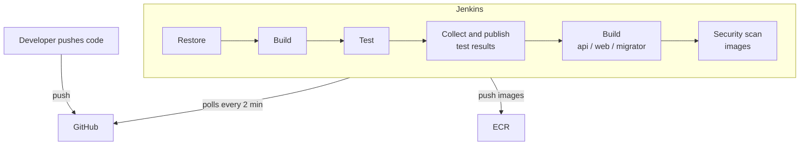
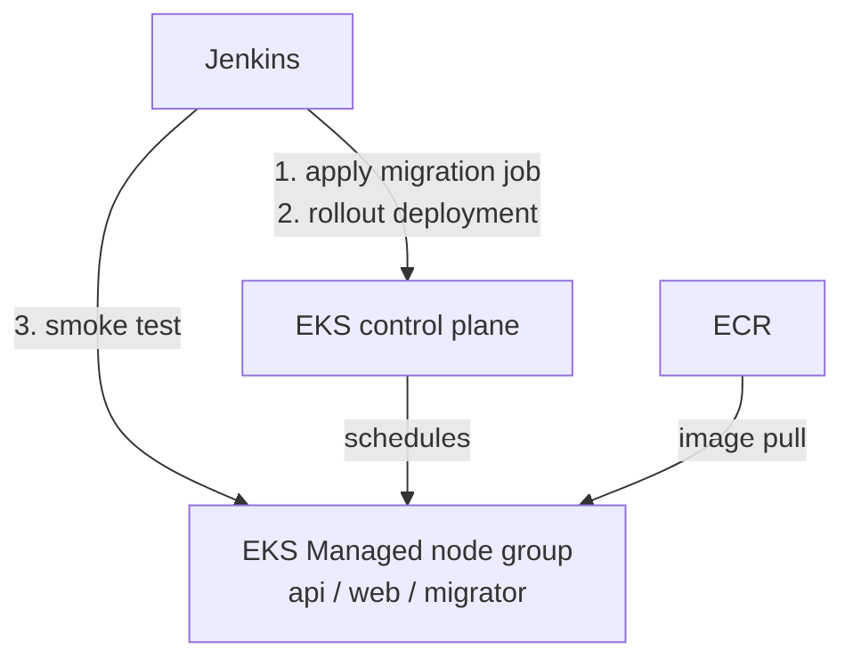

# AWS CI/CD Workflow

## 1. Overview

### 1.1 CI process - build, test, publish

CI is triggered by push of every branch.
CI works identically for staging and prod environment.

The security scan is described in [§2.3 Artifact scans](#23-artifact-scans).

### 1.2 CD process - migrate, deploy, verify

CD is triggered by `master` branch.
`staging` environment.

| Component | Provisioned by | Purpose |
| --- | --- | --- |
| `gaku-staging` EKS cluster | `modules/eks` | Runs the deployed workloads in namespace `gaku` |
| AWS Load Balancer Controller | Helm, in-cluster | Turns the overlay's Ingress objects into a shared ALB |
| External Secrets Operator | Helm, in-cluster | Materialises `gaku-secret` from Secrets Manager |

## 2. DevSecOps

### 2.1 Generals

#### Non-root containers

The docker images use the unprivileged `app` user (UID 1654) from .NET base images to build. The pods do not enforce this yet: without a `securityContext` with `runAsNonRoot` (idea 2), an image without `USER` would still start as root.

#### Pinned tools, update PRs, code owners

Trivy is pinned by digest in `Jenkinsfile.aws` and `.github/workflows/security-scan.yml`; bump both together. The actions in the workflow are pinned by commit SHA, and Dependabot (`.github/dependabot.yml`) opens weekly PRs to update them. `.github/CODEOWNERS` requests the owner's review for the files that can weaken or switch off the scans.

### 2.2 Source scans

Scans that read files in the repository: dependencies, IaC, secrets, code. 
Execute by GitHub Actions in `.github/workflows/security-scan.yml`.

| Job | Scans | Fails on | Results |
| --- | --- | --- | --- |
| `nuget` | NuGet packages of every project, test projects included, with `dotnet list package --vulnerable --include-transitive` | a High or Critical advisory | job log |
| `iac` | Dockerfiles, Kubernetes manifests and Terraform, with `trivy config` | a HIGH or CRITICAL misconfiguration not accepted in `.trivyignore.yaml` | job log, Security tab (SARIF), PR annotations on the changed lines |

### 2.3 Artifact scans

Scans of the built images, in the `Security Scan` stage of `Jenkinsfile.aws` and the `image` job of `.github/workflows/security-scan.yml`. The pull request scan catches a vulnerable base image before the merge; Jenkins scans the exact images it pushes.

| | Jenkins | GitHub Actions (`image` job) |
| --- | --- | --- |
| Runs on | every build of `master` | every PR and push to `master` |
| Scans | the images about to be pushed | the `api`, `web` and `migrator` images, built on the runner and discarded after the scan |
| On findings | the build fails, nothing is pushed | the check fails |
| Results | stage log | job log, Security tab (SARIF) |