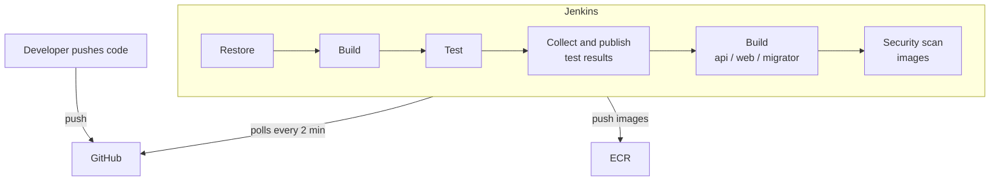
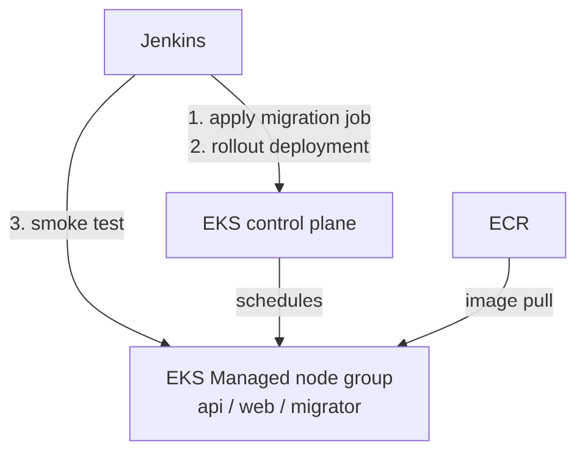

# AWS CI/CD Workflow

## 1. Overview

### 1.1 CI process - build, test, publish

CI is triggered by push of every branch.
CI works identically for staging and prod environment.

The security scan is described in [§2.3 Artifact scans](#23-artifact-scans).

### 1.2 CD process - migrate, deploy, verify

CD is triggered by `master` branch.
`staging` environment.

| Component | Provisioned by | Purpose |
| --- | --- | --- |
| `gaku-staging` EKS cluster | `modules/eks` | Runs the deployed workloads in namespace `gaku` |
| AWS Load Balancer Controller | Helm, in-cluster | Turns the overlay's Ingress objects into a shared ALB |
| External Secrets Operator | Helm, in-cluster | Materialises `gaku-secret` from Secrets Manager |

## 2. DevSecOps

The security measures in place in the build and the images. Update this chapter with every security change. Numbers such as "idea 8" refer to [devsecops-ideas.md](devsecops-ideas.md), which also lists what is not implemented yet.

| Measure | Where |
| --- | --- |
| Containers run as non-root | `docker/Dockerfile` |
| Image scan | `Jenkinsfile.aws`, `.github/workflows/security-scan.yml` |
| NuGet vulnerability scan | `.github/workflows/security-scan.yml` |
| Pinned tools, update PRs, code owners | `.github/` |

### 2.1 Generals

#### Non-root containers

The docker images use the unprivileged `app` user (UID 1654) from .NET base images to build. The pods do not enforce this yet: without a `securityContext` with `runAsNonRoot` (idea 2), an image without `USER` would still start as root.

### 2.2 Source scans

Scans that read files in the repository: dependencies, IaC, secrets, code. They run on pull requests in `.github/workflows/security-scan.yml`, since the files on `master` after the merge are the ones the pull request checked. Pushes to `master` run them again, which catches advisories published since the pull request.

Running them only on PR relies on `master` accepting changes through pull requests alone, with the scan as a required check.

| Job | Checks | Fails on |
| --- | --- | --- |
| `nuget` | NuGet packages of every project, test projects included, with `dotnet list package --vulnerable --include-transitive` | a High or Critical advisory. The command exits 0 either way, so the job searches its output |
| `image` | the `api`, `web` and `migrator` images, built on the runner and discarded after the scan | the findings described in [§2.3 Artifact scans](#23-artifact-scans) |

Findings are in the job log. The `image` job also uploads them to the repository's Security tab as SARIF.

### 2.3 Artifact scans

Scans of the built images. The gate is in the CI Process (`Security Scan`) stage in `Jenkinsfile.aws`.

| | Jenkins |
| --- | --- |
| Runs on | every build of `master` |
| Scans | the images about to be pushed |
| On findings | the build fails, nothing is pushed |
| Results | stage log |