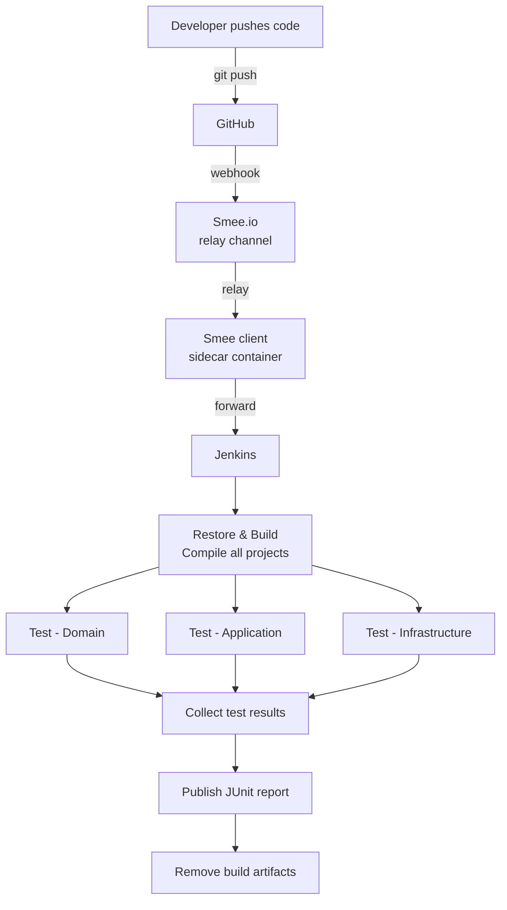
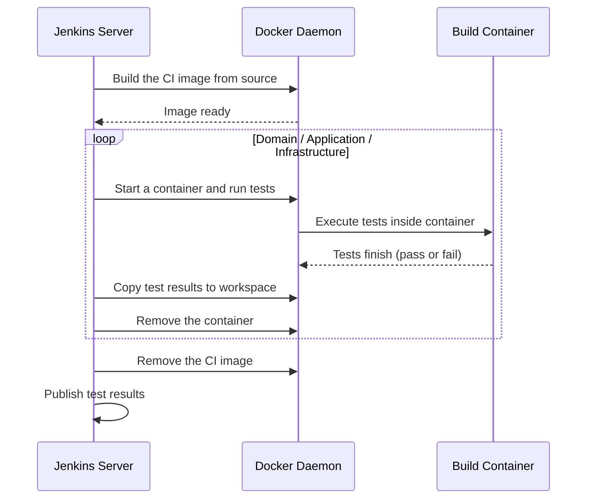

# Local-First CI/CD Workflow

## 1. Overview



## 2. Container Roles

| Container         | Image                                 | Purpose                                                                            |
| ----------------- | ------------------------------------- | ---------------------------------------------------------------------------------- |
| `gaku-jenkins`    | built from `infra/jenkins/local/Dockerfile` | Jenkins server - hosts UI, schedules jobs, runs pipeline                           |
| `smee`            | `node:lts-alpine`                     | Runs `smee-relay.js` - SSE client that forwards GitHub webhook payloads to Jenkins |
| `gaku-ci-<branch>-<build>` | `docker/Dockerfile` target `ci`       | Ephemeral per-build container - compiles and tests .NET code                       |

## 3. Stage Detail



---

## 4. Local CI Setup for Smee & Jenkins

Multibranch job config: Git push or pull request → `https://github.com/tuannamtruong/Gaku` → Webhook to Smee → Relay to Jenkins → one build per branch or pull request → script path `infra/jenkins/local/Jenkinsfile`.

### 4.1 Smee Channel

Go to [smee.io](https://smee.io) and get a new channel.
Save `SMEE_URL` in `infra/jenkins/local/.env`

```
  SMEE_URL=https://smee.io/<your-channel-id>
```

### 4.2 GitHub Webhook

Register the Smee URL as a webhook in the GitHub repo
GitHub repo → Settings → Webhooks → Add webhook

| Field        | Value                    |
| ------------ | ------------------------ |
| Payload URL  | your Smee.io channel URL |
| Content type | `application/json`       |
| Events       | Pushes, Pull requests    |

### 4.3 Jenkins

Start Jenkins and the Smee relay:

```bash
make jenkins_up
make jenkins_password       # initial admin password
```

`jenkins_up` and `jenkins_rebuild` first run `make jenkins_kubeconfig`, which writes `infra/jenkins/local/kubeconfig`
(gitignored) from the host's `minikube` context, with the certificates inlined and the server set to
`https://minikube:8443`. Jenkins resolves that name because it also joins the `minikube` docker network, at the fixed
address `192.168.49.254`, so minikube must have been started at least once. After a `minikube delete`, run
`make jenkins_down jenkins_up`.

Open `http://localhost:8090`, log in, and install plugins: Pipeline, Git, GitHub, GitHub Branch Source, JUnit,
Timestamper.

### 4.4 Pipeline Job Creation

`gaku` is a Multibranch Pipeline. It builds every branch and every pull request opened from a branch of this
repository, and reports each result to GitHub as a commit status. Only `master` runs `Push to Docker Hub` and
`Deploy to Local K8s`. 

1. GitHub → Settings → Developer settings → Fine-grained personal access tokens → Generate, for the `Gaku` repository
   only, with Commit statuses read and write, and Contents and Pull requests read.
2. Jenkins → Manage Jenkins → Credentials → System → Global credentials → Add Credentials: kind
   `Username with password`, username `tuannamtruong`, password the token, ID `github`.
3. `make jenkins_job` creates the job `gaku` from `infra/jenkins/local/job-config.xml` through the Jenkins REST API. It
   asks for the admin password; `JENKINS_USER=<name>` overrides the default user `admin`.
4. Jenkins → `gaku` → Scan Repository Now, so the existing branches build without waiting for a push.
5. GitHub repo → Settings → Branches → add a rule for `master` that requires status checks to pass, and select the
   Jenkins check. It is listed after the first pull request build.

### 4.5 Verification

| Check                 | Command / Action                                                                      |
| --------------------- | ------------------------------------------------------------------------------------- |
| Smee relay is running | `docker logs smee` - should show SSE connected                                        |
| Jenkins is reachable  | `curl -s -o /dev/null -w "%{http_code}" http://localhost:8090` → `200`                |
| Webhook delivery      | Push a commit; GitHub repo → Settings → Webhooks → Recent Deliveries → `200` response |
| Pipeline triggered    | Jenkins → `gaku` → `master` shows a new build                                         |
| Pull request check    | Open a pull request; Jenkins builds `PR-<number>` and the pull request shows its status |

### 4.6 Filemap

```
infra/jenkins/local/
  Dockerfile           custom Jenkins image
  docker-compose.yml   jenkins + smee
  smee-relay.js        pure Node.js SSE client; converts Smee payloads to JSON for Jenkins
  job-config.xml       Jenkins multibranch job config
  Jenkinsfile          builds CI image, runs test containers, publishes JUnit results, deploys to minikube, removes image
  kubeconfig           generated by make jenkins_kubeconfig
  .env

docker/
  Dockerfile           
```

---

## 5. Local CD Setup for minikube + K8s

A push to `master` redeploys minikube: the pipeline pushes the images to Docker Hub as
`docker.io/tuannamtruong/gaku-*:<short commit SHA>`, then runs `helm upgrade` with that tag, and the node pulls them.
The cluster needs the one-time setup below, up to `make gaku_install_local`; the build steps in
[§5.2 Local image build process](#52-local-image-build-process) are the manual path.

### 5.1 Minikube

Minikube install
https://minikube.sigs.k8s.io/docs/start/

Start cluster and enable ingress controller

```
  minikube start
  minikube addons enable ingress
```

### 5.2 Local image build process

Point Docker CLI at minikube's daemon

```
  eval $(minikube docker-env)
```

Build the projects with minikube context

```
  docker build -f docker/Dockerfile --target api      -t gaku-api:latest      .
  docker build -f docker/Dockerfile --target web      -t gaku-web:latest      .
  docker build -f docker/Dockerfile --target migrator -t gaku-migrator:latest .
```

Apply and validate layer by layer.

### 5.3 Layer 1 - k8s resources

```
  make gaku_install_local
```

```
  make k8s_test_layer1
```

### 5.4 Layer 2 - Pods

```
  kubectl rollout status statefulset/postgres -n gaku --timeout=120s
  kubectl wait --for=condition=complete job/db-migrate -n gaku --timeout=120s
  kubectl rollout status deployment/gaku-api -n gaku --timeout=120s
  kubectl rollout status deployment/gaku-web -n gaku --timeout=120s
```

```
  make k8s_test_layer2
```

### 5.5 Layer 3 - test if the API/WEB/DB pods are reachable from inside the cluster via its internal DNS name

```
  make k8s_test_layer3
```

### 5.6 Layer 4 - test in-cluster TCP routing to postgres

```
  make k8s_test_layer4
```

### 5.7 Layer 5 - test Ingress External Routing

```
  make k8s_test_layer5
```

---
