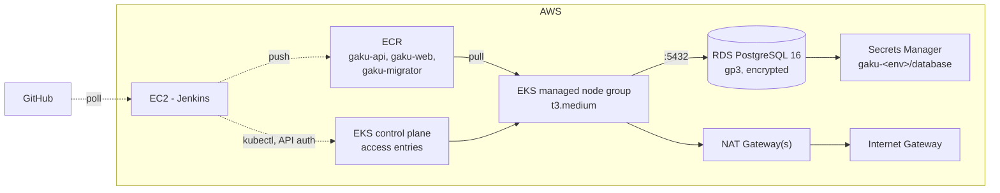
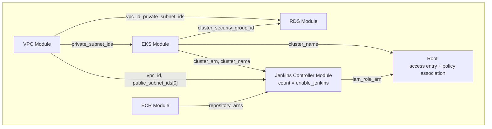

# Infrastructure - AWS

| `infra/terraform/*` | AWS Terraform. |
| --- | --- |
| `infra/terraform/README.md` | the same ground, next to the code |
| `infra/terraform/terraform.mk` | every `tf_*` target, including the bootstrap checklist text |
| `infra/terraform/bootstrap/README.md` | bootstrap apply and teardown detail |


## 1. Infrastructure Topology

Staging and production share the topology with different sizes ([§6 Environments](#6-environments)).



## 2. Dependency Graph



## 3. Provision

### 3.1 Bootstrap
```bash
# State bucket
make tf_bootstrap_init && make tf_bootstrap_plan && make tf_bootstrap_apply

# Verifies versioning, encryption, public access block, lifecycle
make tf_bootstrap_test
```

### 3.2 Staging

Check `terraform.tfvars`.

```bash
make tf_env_init ENV=staging    # Wires the backend from the bootstrap outputs
make tf_env_apply ENV=staging
```

### 3.3 Production

Production needs the staging controller's role to reach the production cluster:
`make tf_env_output ENV=staging | grep jenkins_role_arn`
Copy the ARN into production/terraform.tfvars as `external_deploy_role_arns`

```bash
make tf_env_init ENV=production
make tf_env_apply ENV=production
```

## 4. Deploy

Runs per environment, in section order, once [§3 Provision](#3-provision) has created the cluster.
```bash
# Set cluster context 
make tf_env_kubeconfig ENV=<ENV>
```

### 4.1 Cluster controllers

Terraform stops at the cluster edge. Three controllers run inside the cluster and call AWS on
their own behalf, and each one's IAM role and Pod Identity association already exist — see
[§5.6 in-cluster-controller-identity](#56-in-cluster-controller-identity). Installing the
controllers is a one-off per environment.

The service account names below are not free choices: an association binds a role to one
`namespace/name` pair, and a controller running as anything else gets no credentials. `make
tf_env_output ENV=<env> | grep -A5 controller_service_accounts` prints the pairs Terraform
expects.

The load balancer controller has targets, because a rebuilt cluster needs it again and an Ingress
without it is inert:

```bash
make lbc_install ENV=staging     # chart 3.5.0, values in infra/k8s/eks/controllers/
make lbc_preingress_check    ENV=staging     # release, pods, IngressClass, credentials, association
make lbc_uninstall ENV=staging
```

`LBC_CHART_VERSION` in `infra/k8s/k8s.mk` pins the version; override it on the command line to
upgrade. [docs/archive/2026-09-24-alb-controller-staging.md](archive/2026-09-24-alb-controller-staging.md) carries the reasoning — why
Helm rather than an EKS add-on or Terraform — and how to prove the controller reaches AWS and
balances traffic.

The cluster autoscaler follows the same pattern:

```bash
make ca_install   ENV=staging    # chart 9.53.0 (autoscaler 1.34.2), values in infra/k8s/eks/controllers/
make ca_uninstall ENV=staging
```

`CA_CHART_VERSION` in `infra/k8s/k8s.mk` pins the chart. The autoscaler's minor version must match
the cluster's, so raise it together with `cluster_version` in Terraform — the newest chart is not
automatically the right one.

The External Secrets Operator is still installed by hand:

```bash
helm repo add external-secrets https://charts.external-secrets.io
helm upgrade --install external-secrets external-secrets/external-secrets \
  -n external-secrets --create-namespace \
  --set serviceAccount.name=external-secrets
```

None of these service accounts carries an `eks.amazonaws.com/role-arn` annotation. That
annotation is IRSA; Pod Identity resolves the role from the association instead, which is why the
charts need no AWS-specific values beyond the cluster name.

### 4.3 Gaku

The `gaku` chart in `infra/k8s/gaku/` deploys the API, the web app and the EF Core migration Job.
The chart expects the namespace and `gaku-secret` to exist.

```bash
make gaku_install ENV=staging TAG=42      # namespace, ExternalSecret, then helm upgrade --install
helm test gaku -n gaku                  # /api/health and /health from inside the cluster
```

`gaku_install` runs the same commands as the `Deploy to Staging` stage in `infra/jenkins/aws/Jenkinsfile`, so production, which has no
pipeline yet, deploys with `ENV=production`.

The migration Job is a `pre-install,pre-upgrade` hook: Helm runs it to completion before changing the Deployments, and
a failed migration fails the release without touching them. `--rollback-on-failure` returns a release whose migration
or rollout fails to the previous one. Rollback restores the Kubernetes objects but not the schema, so a migration has
to stay compatible with the previous app version.

| Command | Does |
| --- | --- |
| `helm template gaku infra/k8s/gaku -f infra/k8s/gaku/values-<env>.yaml` | Prints the rendered manifests |
| `helm lint --strict infra/k8s/gaku -f infra/k8s/gaku/values-<env>.yaml` | Checks the templates, and the values against `values.schema.json` |
| `helm history gaku -n gaku` | Lists the releases |
| `helm rollback gaku <revision> -n gaku` | Returns to a release |

The tag goes in with `--set-string`: `--set image.tag=42` passes a number, which the schema rejects.

### 4.4 First Helm deploy

A cluster deployed before the chart holds objects that `kubectl apply` created, and Helm refuses to take them over.
Delete the namespace once with `kubectl delete namespace gaku` before the first `gaku_install`. Nothing in it outlives a
deploy anyway: the database is RDS and `gaku-secret` comes back from Secrets Manager. The ALB is recreated with a new
hostname.

## 5. Module

### 5.1 vpc

The `/16` CIDR is split into `/20` blocks:
- 3 AZs
- 0–7: public subnet
- 8–10: private subnet

1 public and 1 private subnet are assigned to 1 AZ. The rests are reserved.

### 5.2 eks

Authentication from extern node to EKS control plane is through `API auth`.

Pod get AWS credentials by EKS Pod Identity addon.

### 5.3 rds

PostgreSQL 16 on gp3, encrypted, private, logs to CloudWatch. The parameter group sets `rds.force_ssl` and logs statements over one second. 
Pods reach Postgres through the EKS-managed security group.

### 5.4 ecr

`Staging` owns ECR and creates the repositories, which are used by all envs.

Repositories: `gaku-api`, `gaku-web`, `gaku-migrator`. 
- Tags are mutable
- Scanned on push
- Untagged image cleaned up in 7 days
- Max 30 images 


### 5.5 jenkins-controller

Instance for CICD process:
- Amazon Linux 2023 in a public subnet with an EIP
- Install: Corretto, Docker, Jenkins and `kubectl`,

Init log in `/var/log/cloud-init-output.log`.
Shell access is only thorugh Session Manager.
Jenkins gets cluster access from the environment root.

The user data installs Jenkins without plugins, a user, or a job. First-time setup:

```bash
make tf_env_output ENV=staging | grep jenkins_url
make jenkins_aws_password               # unlock password, through SSM Run Command
```

1. Open `jenkins_url`, paste the unlock password, choose "Install suggested plugins", create the admin user.
2. `make jenkins_aws_job` creates the job from `infra/jenkins/aws/job-config.xml`. It asks for the
   admin password; `JENKINS_USER=<name>` overrides the default user `admin`.

The UI is reachable only from `jenkins_allowed_cidrs`. The pipeline does not need it: polling, ECR
pushes and the EKS API are outbound or use their own security group rule.

### 5.6 in-cluster-controller-identity

IAM roles for the controllers in [§4.2 Cluster controllers](#42-cluster-controllers), each bound
to one Kubernetes service account by an `aws_eks_pod_identity_association`. The
`eks-pod-identity-agent` addon in the EKS module is what vends the credentials to the pod.

| Controller | Gets | Scope |
| --- | --- | --- |
| AWS Load Balancer Controller | The upstream `iam_policy.json`, verbatim | Mutations are conditioned on the `elbv2.k8s.aws/cluster` tag it stamps on what it creates |
| External Secrets Operator | `secretsmanager:GetSecretValue`, `DescribeSecret` | The named ARN of this environment's `gaku-<env>/database`, nothing else |
| Cluster autoscaler | Describe everything, resize ASGs | Writes conditioned on `k8s.io/cluster-autoscaler/<cluster> = owned`, the tag the EKS module puts on the node group's ASG |

Pod Identity rather than IRSA: the trust policy names `pods.eks.amazonaws.com` instead of one
cluster's OIDC issuer, so a role is not tied to the cluster it was created for and no OIDC
provider has to be registered per environment.

An association pointing at a service account that does not exist yet is inert rather than an
error, so Terraform never waits on a Helm release and the two can be applied in either order.

## 6. Environments

| | staging | production |
| --- | --- | --- |
| VPC CIDR | `10.0.0.0/16` | `10.1.0.0/16` |
| NAT gateways | 1, shared | 3, one per AZ |
| VPC flow logs | off | on, 14-day retention |
| EKS nodes | 2 × t3.medium, min 1 max 3 | 3 × t3.medium, min 2 max 6 |
| Control plane logs | api, authenticator | api, authenticator, audit |
| RDS | db.t4g.micro, 20–50 GiB, single-AZ | db.t4g.small, 50–200 GiB, multi-AZ |
| RDS backups | 1 day, no final snapshot | 14 days, final snapshot |
| Performance Insights | off | on |
| Deletion protection | off | on |
| Helm values | `infra/k8s/gaku/values-staging.yaml` | `infra/k8s/gaku/values-production.yaml` |
| Gaku replicas | 1 each | 2 each, HPA to 6, PDB minAvailable 1 |
| ECR repositories | CRUD | read only |
| Jenkins | CRUD | read only |

## 7. Secrets

The RDS module generates a 32-character master password with `random_password` and writes it,
along with a ready-made Npgsql connection string, to a Secrets Manager entry named
`gaku-<env>/database`. The JSON keys match `infra/k8s/local/.env.k8s` exactly:

```
POSTGRES_DB  POSTGRES_USER  POSTGRES_PASSWORD  ConnectionStrings__DefaultConnection
```

plus `host` and `port`. The `ExternalSecret` in `infra/k8s/eks/<env>/` copies the whole document into
`gaku-secret` with `dataFrom.extract`, so the keys the pods read through `envFrom` are the same
ones `make gaku_install_local` creates locally from `.env.k8s` — nothing is renamed on the way through.

The connection string carries `SSL Mode=Require;Trust Server Certificate=true`, matching the
`rds.force_ssl` parameter. `Trust Server Certificate` skips CA validation — mounting the RDS CA
bundle into the images and dropping that flag is the stricter option, and worth doing before this
carries real data.

The password is in Terraform state, which is why the bucket in
[§3.1 Bootstrap](#31-bootstrap) is encrypted, versioned and blocked from public access. The
`aws_db_instance` ignores changes to `password`, so rotating it in AWS does not cause drift.

## 8. Verification

| Target | Checks |
| --- | --- |
| `make tf_validate_all` | Syntax check for each module and environment |
| `make tf_bootstrap_test` | Bootstrap state test |
| `make tf_env_plan ENV=<env>` | Diff against an environment |
| `helm lint --strict infra/k8s/gaku -f infra/k8s/gaku/values-<env>.yaml` | Chart templates, and the values against `values.schema.json` |

## 9. Cost
Rough estimate for eu-central-1 on-demand list prices for running 730 hours, excluding data transfer.

| | staging | production |
| --- | --- | --- |
| EKS control plane | ~$73 | ~$73 |
| NAT gateways | ~$38 | ~$115 |
| EKS nodes | ~$70 | ~$105 |
| RDS | ~$13 | ~$55 |
| Jenkins EC2 | ~$35 | |
| **Monthly total** | **~$230** | **~$350** |

NAT gateways and EKS control plane are the biggest expense and neither scales down with traffic. As resting state: keep the bootstrap bucket and RDS.

## 10. Teardown

### 10.1 Destroy blocker

| Blocker | Environment | To unblock |
| --- | --- | --- |
| RDS `deletion_protection` | production | Set to `false` in `environments/production/main.tf` then apply |
| Images in ECR repo | staging | `force_delete` defaults to `true` in `modules/ecr`; apply once so it is in state |
| ALB created by the load balancer controller from the Ingresses | both | `kubectl delete namespace gaku` before the destroy, while the controller is still running |

The ALB, its target groups and its `k8s-*` security groups live in the VPC but not in Terraform state. Destroying the cluster first leaves them orphaned, and the destroy then fails on the subnets and VPC with `DependencyViolation`. Uninstalling the controller first makes the namespace delete hang on the Ingress finalizer. The controllers and the External Secrets Operator need no step of their own: they go with the cluster.

### 10.2 Destroy per env

With kubectl pointed at each environment's cluster in turn:

```bash
make monitoring_archive ENV=production   # production cluster
kubectl delete namespace gaku
make tf_env_destroy ENV=production
make monitoring_archive ENV=staging      # staging cluster
kubectl delete namespace gaku
make tf_env_destroy ENV=staging
```

`monitoring_archive` copies the cluster's metrics to the laptop, see [Monitoring §4 Archive and view](monitoring.md#4-archive-and-view). Skip it where monitoring is not installed.

### 10.3 Bootstrap bucket

After both environments are destroyed.

Comment out `prevent_destroy` in `bootstrap/main.tf`. 
Empty S3 state bucket.

```bash
BUCKET=$(make -s tf_bootstrap_output | grep state_bucket | cut -d'"' -f2)

aws s3 rm "s3://$BUCKET" --recursive
aws s3api delete-objects --bucket "$BUCKET" --delete "$(aws s3api list-object-versions \
  --bucket "$BUCKET" --output json --query '{Objects: Versions[].{Key:Key,VersionId:VersionId}}')"
aws s3api delete-objects --bucket "$BUCKET" --delete "$(aws s3api list-object-versions \
  --bucket "$BUCKET" --output json --query '{Objects: DeleteMarkers[].{Key:Key,VersionId:VersionId}}')"

cd infra/terraform/bootstrap && terraform destroy
```

`delete-objects` takes 1000 keys per call, repeat until `list-object-versions` comes back empty.

### 10.4 What the destroy leaves behind

| Leftover | Env | Why | To remove |
| --- | --- | --- | --- |
| RDS snapshot `gaku-production-final-<timestamp>` | prod | `skip_final_snapshot = false` snapshots on destroy and delays the destroy. | `aws rds delete-db-snapshot --db-snapshot-identifier <id>` |
| `gaku-production/database` secret | prod | `recovery_window_in_days = 7` schedules deletion instead of deleting; staging sets 0 and deletes at once. | `aws secretsmanager delete-secret --secret-id gaku-production/database --force-delete-without-recovery` |

### 10.5 Verify

```bash
aws eks list-clusters
aws rds describe-db-instances --query 'DBInstances[].DBInstanceIdentifier'
aws ec2 describe-nat-gateways --filter Name=state,Values=available --query 'NatGateways[].NatGatewayId'
aws ecr describe-repositories --query 'repositories[].repositoryName'
aws secretsmanager list-secrets --include-planned-deletion --query 'SecretList[].Name'
```

Everything on that list should be empty, besides [What the destroy leaves behind](#104-what-the-destroy-leaves-behind).

## 11. What is not here yet

Terraform and the chart reach as far as a running application. `infra/jenkins/aws/Jenkinsfile` now carries
the ECR push, the migration Job and the staged rollout, but it has never been run: there is no EC2
controller and no cluster to run it against.

| Gap | Phase |
| --- | --- |
| `infra/jenkins/aws/Jenkinsfile` exercised against a real controller and cluster, and a deploy approval step | 8 |
| An ECR push from a workstation — `make docker_push` still targets DockerHub | 8 |

The External Secrets Operator and the cluster autoscaler in
[§4.2 Cluster controllers](#42-cluster-controllers) are still installed by hand, and neither has
an IAM role in `modules/in-cluster-controller-identity` yet, which that section describes as if
all three did. The load balancer controller has `make lbc_install`. All three are cluster-wide
singletons installed once per environment rather than per deploy, so they sit outside the pipeline
by design; moving them into Terraform would mean a Kubernetes or Helm provider and a dependency on
the cluster existing mid-plan.

Also outstanding, independent of the phases: no HTTPS anywhere — the ALB listens on port 80 and
Jenkins is plain HTTP on 8080, so an ACM certificate and an `ssl-redirect` annotation are the next
thing worth doing — and `prevent_destroy` on the state bucket is commented out in
`bootstrap/main.tf`, so a stray `terraform destroy` there is not blocked.
