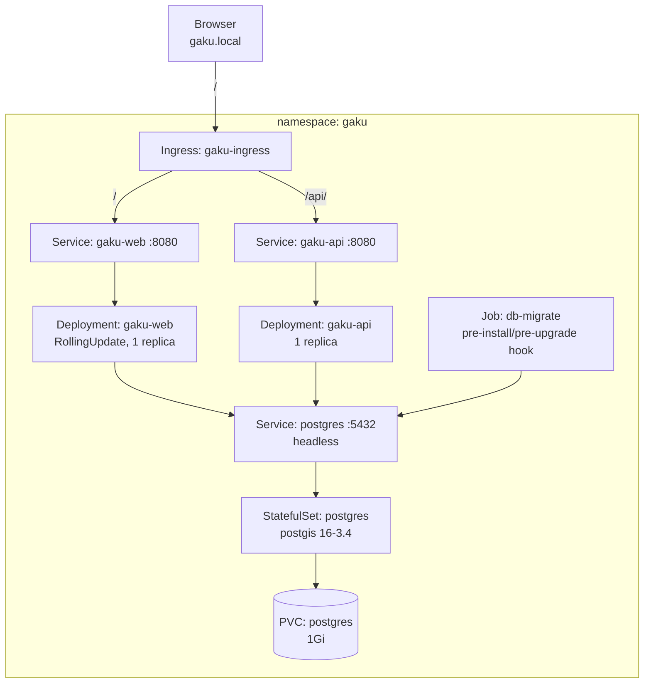

# Infrastructure - Local

Gaku runs on a single-node Kubernetes cluster and is deployed into a local minikube

| `infra/k8s/gaku/` | Helm chart for the API, web app and migration Job. |
| --- | --- |
| `infra/k8s/gaku/values-local.yaml` | Local values: images from the node's daemon, nginx ingress on `gaku.local`. |
| `infra/k8s/local/postgres/` | In-cluster Postgres, outside the chart. |
| `infra/k8s/k8s.mk` | Make targets. |


## 1. Topology



## 2. Environment variables

`infra/k8s/local/.env.k8s` holds four keys. `make gaku_install_local` creates the `gaku-secret` Secret from it, which Postgres
and the chart's pods read:

```
POSTGRES_DB=gaku
POSTGRES_USER=gaku
POSTGRES_PASSWORD=change-me
ConnectionStrings__DefaultConnection=Host=postgres;Port=5432;Database=gaku;Username=gaku;Password=change-me
```

## 3. Deploy

```bash
minikube start
minikube addons enable ingress
make docker_build               # api, web, migrator
minikube image load gaku-api:latest
minikube image load gaku-web:latest
minikube image load gaku-migrator:latest
make gaku_install_local           # namespace, secret, Postgres, then the chart
make k8s_test
helm test gaku -n gaku          # /api/health and /health from inside the cluster
```

`make gaku_install_local` creates what the chart expects to exist, then runs `helm upgrade --install` with `values-local.yaml`.
Postgres stays outside the chart because the migration Job is a pre-install hook: Helm runs it before creating any
chart resource, so a Postgres inside the chart would not exist yet when the migrator connects.

A cluster deployed before the chart holds `gaku-api`, `gaku-web`, their Services, `gaku-config` and `gaku-ingress`
from `kubectl apply`, and Helm refuses to take over objects it did not create. Delete them once before the first
`make gaku_install_local`; Postgres and its volume stay:

```bash
kubectl -n gaku delete deploy/gaku-api deploy/gaku-web svc/gaku-api svc/gaku-web cm/gaku-config ingress/gaku-ingress
```

Add `echo "$(minikube ip) gaku.local" | sudo tee -a /etc/hosts` once, and the site answers at
http://gaku.local.

## 4. Verification

`make k8s_test` runs all five layers:

| Target | Purpose |
| --- | --- |
| `k8s_test_layer1` | Did all k8s resources deployed? |
| `k8s_test_layer2` | Are the pods running and is `db-migrate` completed? |
| `k8s_test_layer3` | Do the in-cluster DNS and health checks work? |
| `k8s_test_layer4` | In-cluster TCP routing to postgres check. |
| `k8s_test_layer5` | Ingress External Routing check. |

## 5. Redeploy

`make gaku_install_local TAG=<tag>` deploys a tag. A failed migration or rollout rolls back to the previous release on its own;
`helm history gaku -n gaku` lists the releases and `helm rollback gaku <revision> -n gaku` returns to one. Rollback
does not undo a migration.

`kubectl rollout restart` to force new pods onto the reloaded image.

`scripts/redeploy-web.sh` does the whole sequence for `Gaku.Web` and verifies each step:

```bash
./scripts/redeploy-web.sh
./scripts/redeploy-web.sh --dry-run
```


## 6. Known gaps

- No resource requests or limits. Nothing declares CPU or memory, so the scheduler cannot make
  informed decisions and nothing is protected from a noisy neighbour.
- Single replica everywhere.
- Secrets are plain Kubernetes Secrets, which are base64-encoded rather than encrypted at rest
  by default.
